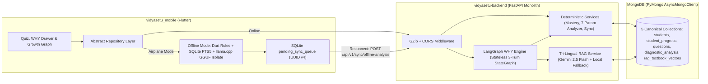

# VidyaSetu

**Mobile-ready, offline-first Agentic EdTech platform for BSE Odisha (Class 9–10, Odia-medium) students.**

Instead of marking an incorrect answer "wrong" and moving on, **VidyaSetu** performs a structured **Mark-Loss Autopsy**. It isolates *why* a student lost marks—whether from an English vocabulary barrier, time pressure, a careless slip, a prerequisite gap, or a conceptual misunderstanding—and delivers textbook-grounded, tri-lingual explanations (authentic Odia Unicode script `ଓଡ଼ିଆ ଲିପି` with inline English technical terms) both online and in complete Airplane Mode.

---

## Key Highlights

* **Hard Deterministic / AI Boundary:** Answer grading, 6-weight mastery math, evidence confidence scoring, textbook citations, and idempotent offline sync run deterministically—never delegated to an LLM.
* **Stateless Multi-Turn LangGraph WHY Engine:** Splits diagnosis across three non-blocking HTTP turns (`attempt` $\rightarrow$ `probe-response` $\rightarrow$ `recovery`) persisted in MongoDB so unstable rural 2G/3G networks never break active sessions.
* **3-Way Language Bridge (Zero Romanised Odia):** Delivers synchronized Odia–English bilingual (`ଓଡ଼ିଆ ଲିପି` + inline English terms), Pure Odia (preserving numerals/years), and Pure English explanations alongside verified technical glossaries and deterministic textbook citations.
* **True Offline-First Mobile Architecture:** Bundles full chapter offline packs (questions, 5 diagnostic probes, recovery items, and 768-dim curriculum RAG chunks) with local SQLite FTS5 (`offline_curriculum.db`), on-device quantized `.gguf` SLMs via Dart FFI + `llama.cpp`, and atomic `$setOnInsert` idempotent batch sync upon reconnection.
* **Zero Answer-Key Leakage:** Public question APIs enforce strict MongoDB projections and Pydantic v2 response models so `correct_answer` and recovery `answer_key` fields never leak to students.
* **Verified Backend Reliability:** **47/47 automated `pytest` tests passing** across all 5 backend implementation phases, verified against live MongoDB.

---

## System Architecture



---

## Monorepo Structure

```text
VidyaSetu/
├── .gitignore
├── README.md
├── vidyasetu-backend/                 # FastAPI + MongoDB + LangGraph Backend (Phases 1–5 Complete)
│   ├── app/
│   │   ├── agents/
│   │   │   └── why_engine.py          # Stateless 3-turn LangGraph WHY Engine
│   │   ├── api/routes/                # health, students, questions, diagnostics, language, sync
│   │   ├── core/config.py             # Pydantic Settings (.env loader)
│   │   ├── database/                  # AsyncMongoClient, 5 canonical collections, idempotent UUID v5 seeder
│   │   ├── repositories/              # Async PyMongo CRUD & local cosine similarity retriever
│   │   ├── schemas/                   # Pydantic v2 contracts & Flutter telemetry AliasChoices
│   │   ├── services/                  # Mastery math, 7-param behavioral analyzer, language bridge, batch sync
│   │   └── main.py                    # FastAPI entrypoint (GZip, CORS, lifespan, /health)
│   ├── docs/                          # Architecture diagrams & engineering blueprints
│   ├── offline slm/                   # 61 BSE Odisha textbook chunks, SQLite FTS5 DB & ChromaDB (768-dim)
│   ├── tests/                         # 47 automated pytest tests (Phases 1–5)
│   ├── .env.example
│   └── requirements.txt
└── vidyasetu_mobile/                  # Flutter Cross-Platform App (Offline-First Client)
    ├── assets/db/
    │   └── offline_curriculum.db      # Bundled static RAG curriculum database (SQLite FTS5)
    ├── lib/                           # Flutter application source
    ├── android/ & ios/                # Native mobile platform runners
    └── pubspec.yaml
```

---

## Tech Stack

| Layer | Technologies |
| :--- | :--- |
| **Backend API & Validation** | Python 3.11+, FastAPI, Uvicorn, Pydantic v2 (`AliasChoices`), `pydantic-settings`, `GZipMiddleware`, `CORSMiddleware` |
| **Database** | MongoDB via native PyMongo `AsyncMongoClient` (5 canonical collections, compound & unique indexes) |
| **Agentic Workflow & Cloud AI** | LangGraph (`StateGraph`), Google GenAI SDK (`google-genai`, `gemini-2.5-flash`) with deterministic offline fallback |
| **Curriculum RAG** | 61 verified BSE Odisha Class 10 textbook chunks, SQLite FTS5 (`offline_curriculum.db`), ChromaDB (`intfloat/multilingual-e5-base`, 768-dim), chapter-filtered Python cosine retriever |
| **Mobile Client & Edge AI** | Flutter (Dart), Dart FFI + `llama.cpp` (`llama_cpp_dart` on Worker Isolates), quantized `.gguf` SLMs (`Q4_K_M`: Qwen2.5-1.5B / Sarvam-2B), native `package:sqlite3` (FTS5) |
| **Testing & Tooling** | `pytest`, `pytest-asyncio`, `httpx`, Android `adb` |

---

## Core Pedagogical & Mathematical Models

### 1. Mark-Loss Autopsy & 5 Diagnostic Probes
Every incorrect answer is evaluated across 5 hypotheses (`language_barrier`, `time_pressure`, `careless_mistake`, `prerequisite_gap`, `conceptual_misunderstanding`) using 5 structured micro-probes (`language_probe`, `untimed_retry`, `prerequisite_probe`, `transfer_probe`, `explain_back`) and a deterministic evidence confidence threshold:

$$\text{confidence} = 0.45 \cdot \text{base} + 0.30 \cdot \text{probe\_match} + 0.12 \cdot \text{history\_alignment} + 0.08 \cdot \text{healthy\_speed}$$

Diagnosis confirms when $\text{confidence} \ge 0.75$ (capped at 2 probes per question).

### 2. Deterministic 6-Weight Mastery Formula
All six component scores are clamped strictly to $[0.0, 100.0]$:

$$\text{overall\_mastery} = \text{round}\big(0.30 \cdot c + 0.20 \cdot p_{\text{prev}} + 0.15 \cdot p_{\text{req}} + 0.15 \cdot e + 0.10 \cdot t + 0.10 \cdot \text{conf},\ 2\big)$$

* Chapters are marked completed when $\text{overall\_mastery} \ge 75.0$.
* Mean `english_comprehension` maps continuously across 4 progressive English scaffolding levels ($\le 45.0 \rightarrow 1$, $\le 65.0 \rightarrow 2$, $\le 82.0 \rightarrow 3$, $> 82.0 \rightarrow 4$).
* Verified recovery (`has_student_improved == True`) applies a shared cause-specific boost (`+8.0` to the diagnosed dimension, `+5.0` to `confidence_level`) and updates `students.recommended_next_task` identically across both cloud and offline sync.

---

## Quickstart Guide

### Prerequisites
* **Python 3.11+**
* **MongoDB** running locally (`mongodb://localhost:27017`) or a MongoDB Atlas URI
* **Flutter SDK** (for `vidyasetu_mobile`)
* *(Optional)* **Google Gemini API key** — if omitted, the backend automatically runs its deterministic textbook-grounded fallback without crashing.

### 1. Run the FastAPI Backend (`vidyasetu-backend`)

```powershell
cd vidyasetu-backend

# Create and activate virtual environment
python -m venv .venv
.\.venv\Scripts\Activate.ps1

# Install dependencies
python -m pip install -r requirements.txt
```

Create a `.env` file from `.env.example`:

```env
MONGODB_URI=mongodb://localhost:27017
MONGODB_DB_NAME=vidyasetu
GEMINI_API_KEY=
GEMINI_MODEL=gemini-2.5-flash
CORS_ORIGINS=["*"]
```

Seed the database idempotently (imports all 61 textbook chunks + 5 BSE Odisha Class 10 questions):

```powershell
python -m app.database.seed
```

Start the API server bound to `0.0.0.0` so both Android emulators (`http://10.0.2.2:8000`) and physical phones on local Wi-Fi (`http://<YOUR_LAN_IPV4>:8000`) can connect:

```powershell
python -m uvicorn app.main:app --host 0.0.0.0 --port 8000 --reload
```

* **Health Check:** `http://localhost:8000/api/v1/health`
* **Swagger API Docs:** `http://localhost:8000/docs`

Run the automated test suite:

```powershell
python -m pytest -v
# Expected: 47 passed (100% pass rate)
```

### 2. Run the Flutter Mobile App (`vidyasetu_mobile`)

```powershell
cd vidyasetu_mobile
flutter pub get
flutter run
```

*(For Airplane Mode on-device SLM testing on a physical `arm64-v8a` Android device, push your quantized `Q4_K_M` `.gguf` model via USB to private app storage rather than bundling it in the APK:)*

```powershell
adb shell mkdir -p /sdcard/Android/data/com.example.vidyasetu_mobile/files/models
adb push path\to\model-q4_k_m.gguf /sdcard/Android/data/com.example.vidyasetu_mobile/files/models/vidyasetu_slm.gguf
```

---

## Backend API Surface

| Domain | Endpoints | Highlights |
| :--- | :--- | :--- |
| **Health** | `GET /health`, `GET /api/v1/health` | Live MongoDB ping returning `healthy` or `degraded` for mobile offline routing |
| **Students** | `POST /api/v1/students`, `GET /api/v1/students/{student_id}` | Lowercase UUID v4 profiles, exposure level & planner task tracking |
| **Progress** | `POST / GET /api/v1/students/{student_id}/progress` (+ `/{chapter_name}`) | Atomic `$setOnInsert` upserts, 6-weight mastery math, Flutter chart aliases |
| **Questions** | `GET /api/v1/questions`, `GET /api/v1/questions/{question_id}` | Student-safe MongoDB projections guaranteeing zero answer-key leaks |
| **WHY Engine** | `POST /api/v1/diagnostics/attempt`, `.../probe-response`, `.../recovery` | Stateless 3-turn LangGraph autopsy loop with gated recovery boosts |
| **Language** | `POST /api/v1/language/explain`, `GET /api/v1/language/progress/{student_id}` | Grounded 3-Way Language Bridge and bilingual progression telemetry |
| **Offline Sync** | `POST /api/v1/offline-packs`, `POST /api/v1/sync/offline-analysis` | Chapter offline bundles (404 guard) & chronological, idempotent batch sync |

---

## Project Status & Roadmap

* [x] **Phase 1:** Core FastAPI architecture, PyMongo `AsyncMongoClient`, canonical MongoDB indexes, GZip/CORS, `/health`
* [x] **Phase 2:** Student profiles, atomic chapter progress upserts, 6-weight deterministic mastery & exposure sync
* [x] **Phase 3:** Student-safe question bank, 61 BSE Odisha 768-dim curriculum chunks, Odia technical glossaries
* [x] **Phase 4:** Stateful LangGraph WHY Engine, 7-parameter categorical analyzer, Tri-Lingual RAG Language Bridge
* [x] **Phase 5:** Mobile offline chapter packs & idempotent `$setOnInsert` batch sync with partial failure isolation (47/47 tests)
* [ ] **Phase 6 (In Progress):** Flutter UI integration (`CloudDiagnosticRepo` $\leftrightarrow$ `OfflineDiagnosticRepo`), on-device `llama.cpp` Worker Isolate streaming, and resumable Wi-Fi GGUF model downloader